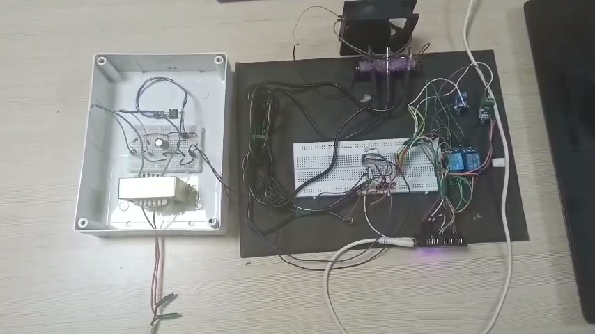
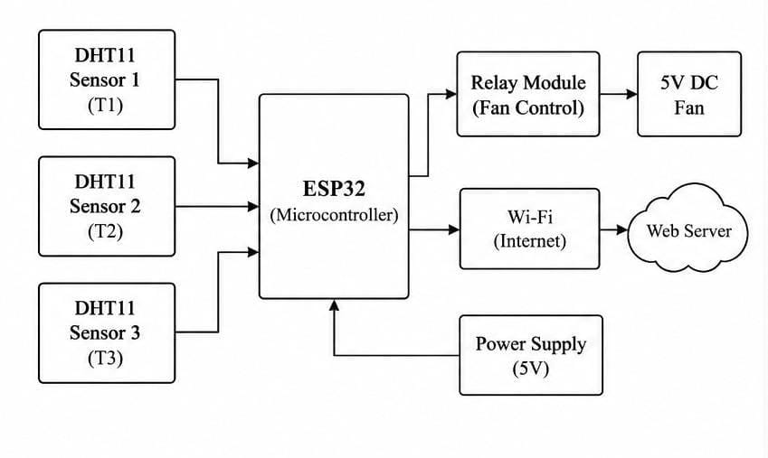
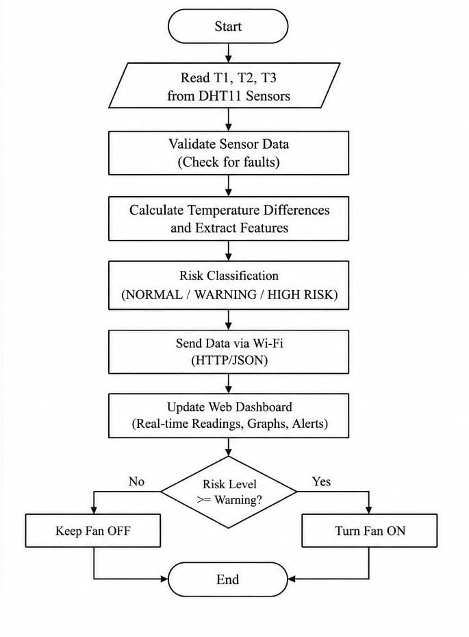
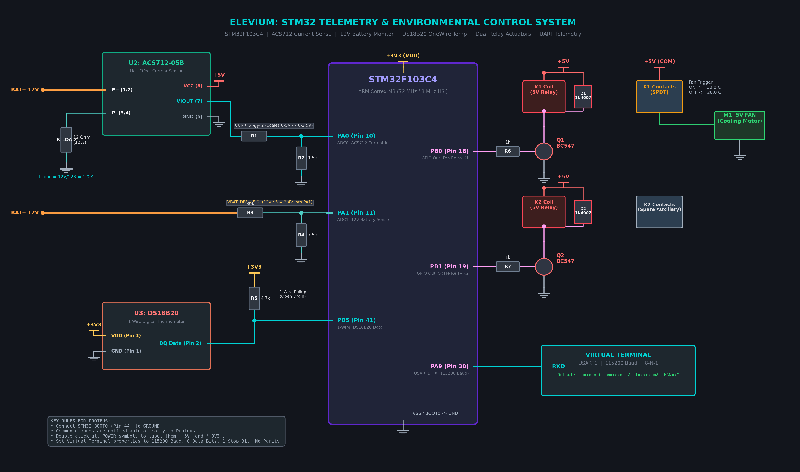
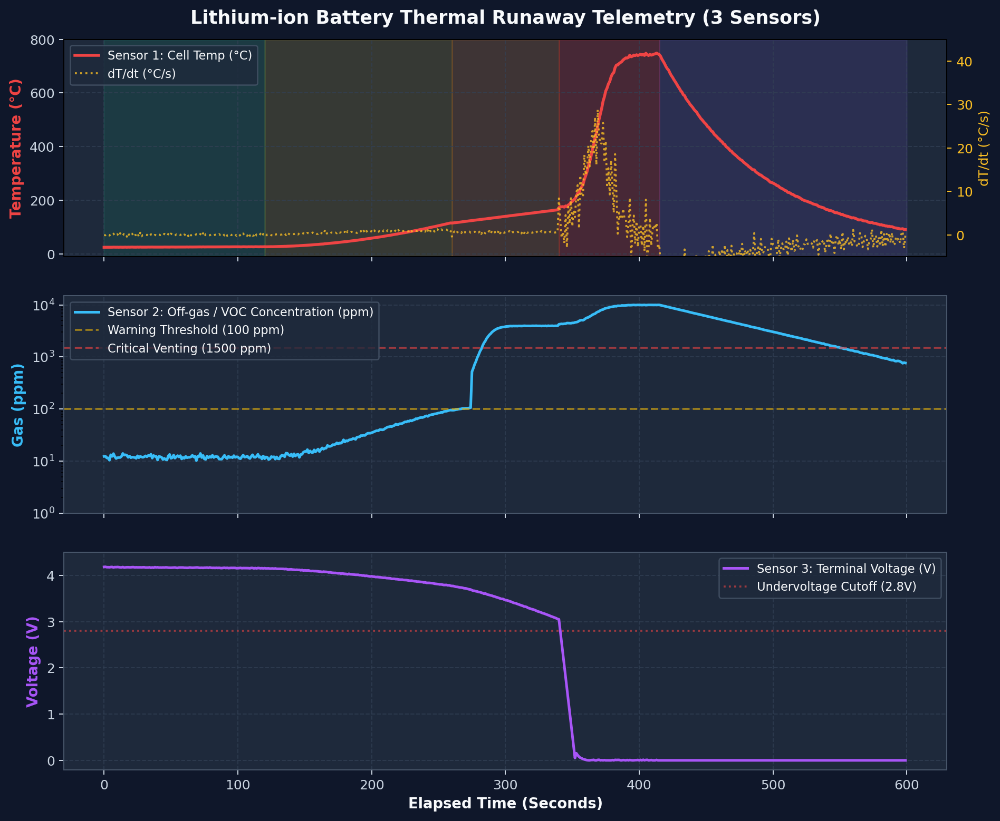
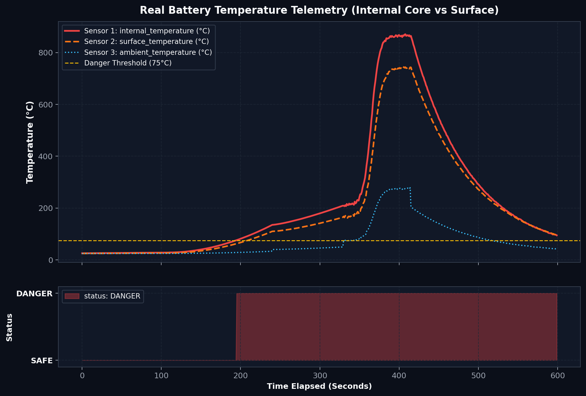
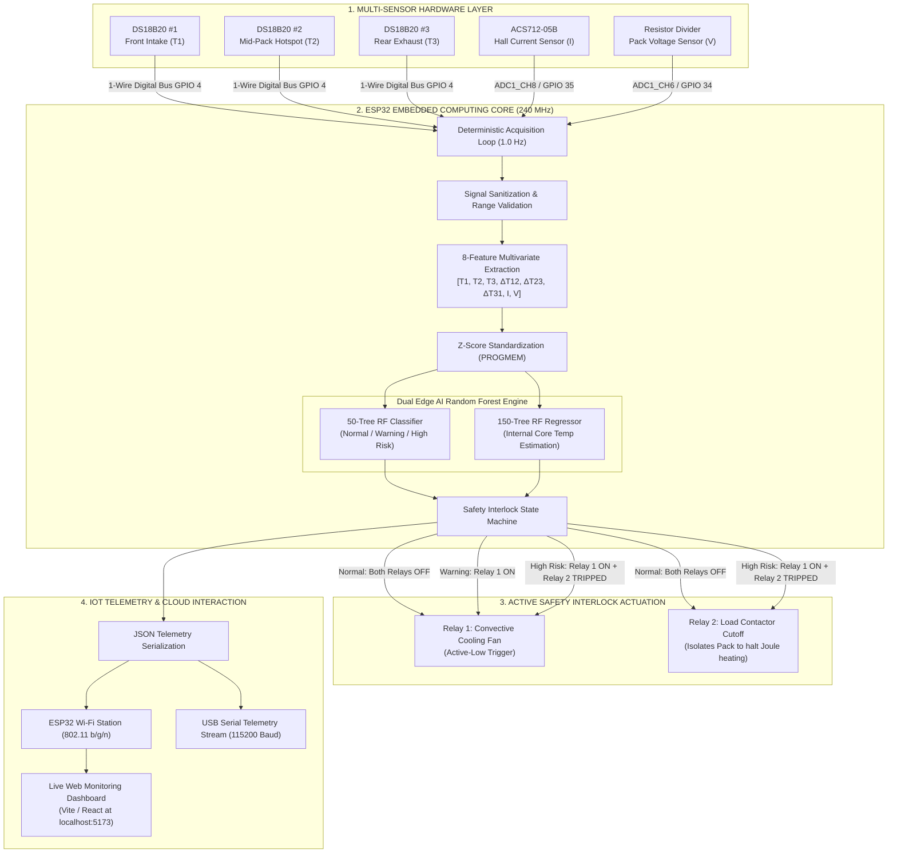
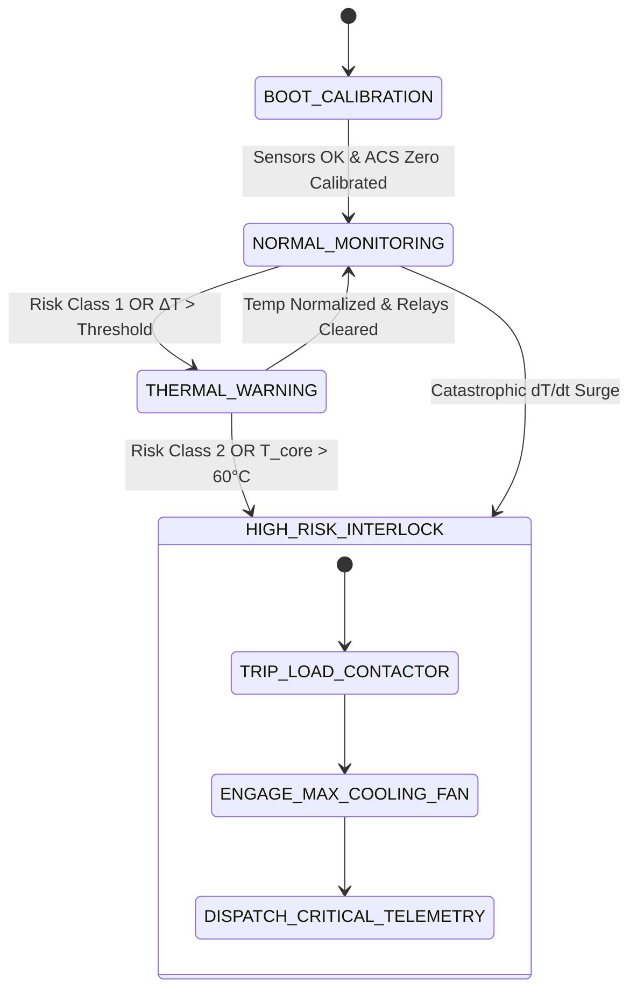

# Elevium: Edge AI-Powered EV Battery Thermal Runaway Early Detection & Active Safety Interlock System

<div align="center">

[](https://opensource.org/licenses/MIT)
[](https://www.espressif.com/en/products/socs/esp32)
[](https://isocpp.org/)
[-brightgreen.svg?style=for-the-badge&logo=scikit-learn)](https://scikit-learn.org/)
[]()
[]()

**An ultra-reliable, non-invasive embedded safety node that detects lithium-ion thermal runaway precursors in real time using multi-point temperature gradient analysis, Hall-effect current monitoring, edge machine learning, and autonomous dual-stage relay isolation.**

[System Overview](#-system-overview) • [Problem Statement](#-problem-statement) • [System Architecture](#-system-architecture) • [Hardware Specifications](#-hardware-specifications) • [Edge AI & ML Pipeline](#-edge-ai--machine-learning-pipeline) • [Safety Interlock Logic](#-dual-stage-active-safety-interlock) • [Firmware Guide](#-firmware-architecture) • [Getting Started](#-getting-started) • [Team Vision X](#-team-vision-x)

---

</div>

> *"A battery can appear normal on the outside while dangerous heat develops inside."*  
> — **Team Vision X, Elevium 2026**

---

## 📌 System Overview

Lithium-ion battery packs are the core energy storage medium for modern Electric Vehicles (EVs). However, internal defects, dendritic growth, overcharging, and mechanical stress can trigger **Thermal Runaway**—an exothermic self-propagating reaction where cell temperatures rapidly exceed $800^\circ\text{C}$, releasing toxic flammable off-gases and causing catastrophic pack destruction.

Traditional Battery Management Systems (BMS) rely on single-point threshold cutoffs or external bimetallic fuses. By the time surface temperatures breach standard safety limits, the internal cell core jelly-roll has often already entered irreversible exothermic decomposition.

**Elevium** is an edge-intelligent early detection node powered by an **ESP32 Dual-Core microcontroller (240 MHz)** that combines:
1. **Multi-Point Spatial Thermal Gradients**: 3x Dallas DS18B20 digital temperature sensors mapping temperature differentials ($\Delta T = T_x - T_y$) across intake, mid-pack, and exhaust zones.
2. **Current & Voltage Telemetry**: ACS712-05B Hall-Effect current sensing with zero-point autocalibration and precision resistor divider voltage tracking.
3. **Dual Edge AI Machine Learning Engine**:
   - **50-Tree Random Forest Classifier** in `PROGMEM` flash memory for 3-state real-time risk classification (`NORMAL`, `WARNING`, `HIGH RISK`).
   - **150-Tree Random Forest Regressor** providing non-invasive internal core temperature estimation ($\hat{T}_{\text{core}}$) to detect internal hotspotting before casing heating occurs.
4. **Dual-Stage Active Safety Actuation**: Autonomous active-low relay switching controlling a forced-air convective cooling blower fan and an emergency load contactor to instantly eliminate Joule self-heating ($P = I^2 R$).
5. **Real-Time IoT Telemetry Stream**: Continuous Wi-Fi telemetry packet dispatch to a live web monitoring dashboard for diagnostics, logging, and fleet supervisory control.

---

## 📸 System Visual Gallery

| Hardware Bench Prototype | Live Web Dashboard (High Risk Alert) |
| :---: | :---: |
|  |  |
| *Physical test bench: ESP32 MCU, 3x DS18B20 probes, ACS712 sensor, 2-channel relay module, cooling fan, and regulated power supply.* | *Real-time dashboard displaying ML prediction (`HIGH RISK`), autonomous contactor trip, and convective cooling fan engaged.* |

| System Block Diagram | Edge Processing Flow Diagram |
| :---: | :---: |
|  |  |
| *Slide 4: End-to-end hardware architecture from sensor acquisition to microcontroller, relay fan control, and Wi-Fi cloud connectivity.* | *Slide 5: Deterministic edge execution loop: acquisition, validation, gradient feature extraction, risk prediction, and actuator actuation.* |

| Multi-Zone Telemetry Dashboard | Electronic Circuit Schematic (Proteus) |
| :---: | :---: |
|  |  |
| *Detailed telemetry cards: Estimated Core Temp (54.3°C), Surface Temp (48.5°C), $\Delta T$ (16.4°C), Pack Voltage (50.2V), Pack Current (0.0A).* | *Electronic wiring schematic: Sensor conditioning, transistor relay drivers (BC547), flyback diodes (1N4007), and UART streaming.* |

---

## ⚠️ Problem Statement & Scientific Motivation

### The Physics of Li-Ion Thermal Runaway
Thermal runaway occurs in distinct thermodynamic phases:
1. **SEI Layer Decomposition** ($80^\circ\text{C} - 120^\circ\text{C}$): The solid electrolyte interphase (SEI) on the anode breaks down exothermically.
2. **Anode & Electrolyte Reaction** ($120^\circ\text{C} - 140^\circ\text{C}$): Intercalated lithium reacts directly with organic solvents.
3. **Separator Meltdown** ($130^\circ\text{C} - 170^\circ\text{C}$): Polyethylene/polypropylene separators melt, causing massive internal micro-short circuits.
4. **Cathode Decomposition & Oxygen Release** ($180^\circ\text{C} - 250^\circ\text{C}$): Metal oxide cathodes release free oxygen, generating an uncontrolled combustion environment with temperatures climbing $>40^\circ\text{C}/\text{s}$ up to $900^\circ\text{C}$.

### The Thermal Lag Dilemma
Because lithium-ion cells exhibit significant radial thermal resistance ($R_{\text{th, radial}} \gg R_{\text{th, axial}}$), heat generated at the internal jelly-roll takes dozens of seconds to propagate to the external aluminum or steel casing. By the time a single external probe exceeds a fixed alarm limit (e.g. $60^\circ\text{C}$), the core may already be at $>150^\circ\text{C}$.

```
  Internal Jelly-Roll (Core)                External Canister / Casing
   ┌───────────────────────────┐             ┌─────────────────────────┐
   │ Internal Joule &          │  R_thermal  │ External Surface Probe  │
   │ Exothermic Reaction Heat  ├────────────►│ (Lags by 15°C - 30°C!)  │
   │ T_core: 75°C - 150°C      │   Delay     │ T_surface: 38°C - 50°C  │
   └───────────────────────────┘             └─────────────────────────┘
```

> **Battery Ageing Study Benchmark**: In empirical lithium-ion degradation studies, increasing operating/storage temperature from $25^\circ\text{C}$ to $42.5^\circ\text{C}$ causes cells to reach 85% State of Health (SOH) **approximately six times faster**. Early detection and immediate thermal mitigation prevent both catastrophic fires and premature pack degradation.

---

## 🔬 Experimental Validation & Thermal Kinetics

The Elevium detection engine was evaluated and validated against laboratory-grade thermal runaway telemetry data collected across multi-sensor channels:

| Thermal Runaway Telemetry (3 Sensors) | Internal Core vs. Surface Temperature Lag |
| :---: | :---: |
|  |  |
| *Experimental runaway kinetics: Temperature curve, rate of rise $dT/dt$, off-gas VOC concentration (ppm), and voltage collapse to 0V at $t = 345\text{ s}$.* | *Dual-node temperature curves illustrating core thermal runaway starting at $t \approx 195\text{ s}$ while surface temperature lags significantly.* |

---

## 🏗️ System Architecture

Elevium operates as a deterministic, real-time edge computing node. Below is the complete signal flow from physical telemetry to ML classification and autonomous mitigation:



### Finite State Machine (FSM)



---

## ⚡ Hardware Specifications & Pinout Map

| Module / Component | ESP32 Pin | Pin Mode | Operating Voltage | Description / Signal Conditioning |
| :--- | :--- | :--- | :--- | :--- |
| **DS18B20 Sensor Bus** | `GPIO 4` | Digital Input/Output | $3.3\text{V} - 5.0\text{V}$ | Dallas 1-Wire Protocol with external $4.7\text{ k}\Omega$ pull-up resistor to $3.3\text{V}$. Multi-drop addressable. |
| **ACS712-05B Current** | `GPIO 35` (ADC1_CH7) | Analog Input | $5.0\text{V}$ VCC | Hall-Effect linear current sensor ($185\text{ mV/A}$). Output scaled via $10\text{k}\Omega / 20\text{k}\Omega$ voltage divider ($1.5\times$ recovery factor) to protect $3.3\text{V}$ ADC. |
| **DC Voltage Sensor** | `GPIO 34` (ADC1_CH6) | Analog Input | Up to $25.0\text{V}$ DC | Resistor voltage divider ($5:1$ attenuation ratio). Measured ADC voltage multiplied by $5.0$. |
| **Relay 1 (Cooling Fan)** | `GPIO 27` | Digital Output | $5.0\text{V}$ Relay Coil | Active-Low optocoupler relay switching $5\text{V} / 12\text{V}$ DC high-flow brushless blower fan. |
| **Relay 2 (Load Contactor)** | `GPIO 26` | Digital Output | $5.0\text{V}$ Relay Coil | Active-Low relay controlling main battery power contactor. Trips open on High Risk to break circuit ($I \to 0\text{ A}$). |
| **Power Supply** | `VIN` / `GND` | Power Input | $5.0\text{V} \pm 5\%$ DC | Filtered step-down power supply from bench transformer / linear regulator. |
| **UART Serial Telemetry** | `TX0 (GPIO 1)` | UART Output | $3.3\text{V}$ TTL | $115,200\text{ Baud}$, 8 data bits, no parity, 1 stop bit ($8\text{-N-}1$). |

---

## 🧠 Edge AI & Machine Learning Pipeline

### 1. Multivariate Feature Vector Extraction
At every $1.0\text{ s}$ sampling period, the firmware transforms raw physical readings into an 8-dimensional feature vector:

$$\mathbf{x} = \begin{bmatrix} T_1 \\ T_2 \\ T_3 \\ \Delta T_{12} \\ \Delta T_{23} \\ \Delta T_{31} \\ I \\ V \end{bmatrix} = \begin{bmatrix} \text{Front Intake Temperature } (^\circ\text{C}) \\ \text{Mid-Pack Hotspot Temperature } (^\circ\text{C}) \\ \text{Rear Exhaust Temperature } (^\circ\text{C}) \\ T_1 - T_2 \\ T_2 - T_3 \\ T_3 - T_1 \\ \text{Battery Current } (\text{Amperes}) \\ \text{Terminal Voltage } (\text{Volts}) \end{bmatrix}$$

### 2. On-Device Z-Score Normalization
Before evaluating tree thresholds, features are standardized in-place using pre-computed scaler parameters stored directly in ESP32 `PROGMEM`:

$$z_i = \frac{x_i - \mu_i}{\sigma_i}$$

| Feature Index | Feature Name | Mean ($\mu$) | Standard Deviation ($\sigma$) |
| :---: | :--- | :---: | :---: |
| `0` | $T_1$ (Intake Temp) | $38.809^\circ\text{C}$ | $10.149$ |
| `1` | $T_2$ (Mid-Pack Temp) | $38.765^\circ\text{C}$ | $10.726$ |
| `2` | $T_3$ (Rear Temp) | $28.851^\circ\text{C}$ | $5.305$ |
| `3` | $\Delta T_{12}$ ($T_1 - T_2$) | $0.045^\circ\text{C}$ | $4.160$ |
| `4` | $\Delta T_{23}$ ($T_2 - T_3$) | $9.914^\circ\text{C}$ | $11.864$ |
| `5` | $\Delta T_{31}$ ($T_3 - T_1$) | $-9.959^\circ\text{C}$ | $11.410$ |
| `6` | $I$ (Current Amps) | $1.240\text{ A}$ | $0.783$ |
| `7` | $V$ (Terminal Volts) | $3.728\text{ V}$ | $0.321$ |

### 3. Tree Representation & Inference Engine
The trees are compiled into compact C++ structs stored in flash memory (`PROGMEM`), avoiding dynamic heap allocation:

```cpp
struct Node {
    int16_t left_child;          // -1 if leaf
    int16_t right_child;         // -1 if leaf
    int16_t feature_idx;         // Index [0..7]
    float threshold_or_value;    // Decision threshold or leaf prediction
};
```

- **Random Forest Classifier**: 50 independent decision trees vote on the risk class. The class with the plurality vote is selected.
- **Random Forest Regressor**: 150 regression trees evaluate internal core temperature ($\hat{T}_{\text{core}}$), averaged across all estimators.
- **Inference Latency**: Benchmarked at **$<12\text{ ms}$** on the 240 MHz ESP32 Xtensa core, leaving $>98\%$ CPU headroom for real-time safety checks.

---

## 🛡️ Dual-Stage Active Safety Interlock

The system translates predicted risk states into deterministic physical actions:

| Risk Class | State Label | System Conditions | Relay 1 (Cooling Fan) | Relay 2 (Load Contactor) | Action Taken |
| :---: | :---: | :--- | :---: | :---: | :--- |
| `0` | **NORMAL** | Temperatures within nominal envelope ($T < 38^\circ\text{C}$, $\Delta T < 3.0^\circ\text{C}$), current stable. | **OFF** | **CLOSED (CONNECTED)** | Passive monitoring. Normal vehicle driving & charging allowed. |
| `1` | **WARNING** | Spatial thermal gradient detected ($\Delta T > 3.0^\circ\text{C}$) or rapid rate of rise ($dT/dt > 2.0^\circ\text{C}/\text{min}$). | **ON (100% Flow)** | **CLOSED (CONNECTED)** | Convective cooling fan engaged to dissipate localized heat pockets before propagation. |
| `2` | **HIGH RISK** | Critical thermal gradient, severe core overtemperature ($\hat{T}_{\text{core}} > 55^\circ\text{C}$), or cell voltage sag. | **ON (Emergency)** | **OPEN (ISOLATED)** | **Immediate Emergency Cutoff!** Contactor trips to halt discharge/charge current ($I \to 0\text{ A}$), eliminating Joule heating ($I^2 R$) while cooling fan suppresses thermal runaway. |
| `-1` | **FAULT / INVALID** | Sensor disconnected (`NAN`), 1-Wire bus error, or out-of-range ADC. | **OFF (Fail-Safe)** | **OPEN (Fail-Safe)** | Fail-safe isolation mode. High-priority alert broadcast. |

---

## 💻 Firmware Architecture

```
Elevium/
├── .github/
│   └── workflows/
│       └── ci.yml                 # Automated Continuous Integration (GCC/Clang build test)
├── docs/
│   ├── assets/
│   │   ├── block_diagram.jpg          # System block diagram (Slide 4)
│   │   ├── flow_diagram.jpg           # Processing flow diagram (Slide 5)
│   │   ├── hardware_prototype.jpg     # Bench test photograph with ESP32 & sensors
│   │   ├── dashboard_overview.jpg     # Multi-zone live dashboard capture
│   │   ├── dashboard_alert_view.jpg   # Critical alert & contactor isolation view
│   │   ├── proteus_simulation.jpg     # Proteus schematic simulation capture
│   │   ├── schematic_stm32.png        # Electronic circuit wiring schematic
│   │   ├── supercap_simulation.png    # LTspice power holdup simulation
│   │   ├── thermal_runaway_kinetics.png # Real battery runaway experimental curves
│   │   └── training_curves.png        # Core vs surface thermal lag plot
│   └── presentation/
│       └── Team_VisionX_Elevium_Presentation.pptx # Hackathon presentation slide deck
├── media/
│   └── Elevium_Hardware_Demonstration.mp4     # Complete physical hardware demo video
├── EV_Battery_Project.ino         # Primary Arduino firmware sketch
├── model_trees.h                  # 50-tree classifier + 150-tree regressor flash arrays
├── random_forest_model.h          # Dual-ML C++ inference engine & PROGMEM tree evaluator
├── feature_calculation.h          # 8-feature multivariate extraction pipeline & validation
├── ds18b20_sensor.h               # Dallas 1-Wire multi-zone temperature sensor driver
├── acs712_sensor.h                # ACS712-05B Hall-Effect current sensor driver & calibration
├── voltage_sensor.h               # Precision resistor divider DC voltage sensor driver
├── relay_control.h                # Dual-relay active safety actuator driver
├── wifi_communication.h           # Wi-Fi station mode & HTTP JSON telemetry streaming
├── .gitignore                     # Git ignore rules for embedded, build artifacts, and OS files
├── LICENSE                        # MIT Open Source License
└── README.md                      # Comprehensive project documentation
```

### Telemetry JSON Specification
The firmware serializes live diagnostics into lightweight JSON packets:

```json
{
  "seq": 142,
  "device": "Elevium-Node-01",
  "uptime_ms": 142050,
  "t1": 32.10,
  "t2": 48.50,
  "t3": 35.40,
  "dT12": -16.40,
  "dT23": 13.10,
  "dT31": 3.30,
  "current_amps": 0.000,
  "pack_volts": 50.200,
  "risk_class": 2,
  "risk_label": "HIGH_RISK",
  "core_temp_est": 54.30
}
```

---

## 🚀 Getting Started

### Prerequisites
- **Arduino IDE** (version 2.0 or higher) OR **PlatformIO IDE** (VS Code)
- **ESP32 Board Package**: Install via Arduino Boards Manager (`https://raw.githubusercontent.com/espressif/arduino-esp32/gh-pages/package_esp32_index.json`)
- **Required Arduino Libraries**:
  - `OneWire` by Paul Stoffregen (v2.3.8+)
  - `DallasTemperature` by Miles Burton (v3.9.0+)

### Flashing Procedure
1. **Clone the Repository**:
   ```bash
   git clone https://github.com/harikrishnanm5/Elevium-Hackaton-Team5-VisionX.git
   cd Elevium-Hackaton-Team5-VisionX
   ```

2. **Configure Wi-Fi & Telemetry**:
   Open `wifi_communication.h` and configure your local Wi-Fi credentials and dashboard endpoint:
   ```cpp
   const char* WIFI_SSID     = "Your_WiFi_SSID";
   const char* WIFI_PASSWORD = "Your_WiFi_Password";
   const char* TELEMETRY_URL = "http://192.168.1.100:5173/api/telemetry";
   ```

3. **Current Sensor Calibration**:
   Ensure **ZERO current** passes through the ACS712 terminal block during boot. The ESP32 samples 200 ADC readings during `setup()` to establish the baseline voltage offset.

4. **Select Board & Port**:
   - Board: **ESP32 Dev Module**
   - Flash Frequency: **80MHz**
   - Partition Scheme: **Default 4MB with spiffs (1.2MB APP / 1.5MB SPIFFS)** or **Huge APP (3MB No OTA)**
   - Upload Speed: **921600**
   - Port: Select your USB-to-UART COM port.

5. **Upload & Monitor**:
   Click **Upload**, then open the Serial Monitor at **115200 Baud**.

---

## 📊 Live Web Telemetry Dashboard

The Elevium telemetry stream integrates seamlessly with web-based monitoring dashboards (e.g. Vite + React / WebSockets / HTTP REST):

- **Real-Time Gauges**: Surface temperatures ($T_1, T_2, T_3$), internal core estimate ($\hat{T}_{\text{core}}$), and temperature rate of rise ($dT/dt$).
- **Thermal Imbalance Bar**: Visualizes cell gradient balance ($\Delta T = T_{\max} - T_{\min}$) against the critical threshold ($3.0^\circ\text{C}$).
- **Active Safety Status**: Displays real-time relay state (Cooling Fan Duty % and Load Contactor Tripped/Closed).
- **Clinical/Engineering Diagnostic Log**: Automatic natural-language incident explanations generated from multivariate risk conditions.

---

## 👥 Team Vision X

Developed with dedication for the **Elevium Hackathon 2026** by:

- **Srimathi M** — Sensor Interface Engineering & Hardware Integration
- **Sri Gayatri G** — Thermodynamic Modeling & Dataset Synthesis
- **Hari Krishnan M** — Embedded Firmware, TinyML Pipeline & System Integration
- **Udaya Sankar K** — Power Electronics, Relay Interlocks & Actuation Subsystems

---

## 📄 License

This project is licensed under the **MIT License** — see the [LICENSE](LICENSE) file for complete details.

```
Copyright (c) 2026 Team Vision X
Srimathi M | Sri Gayatri G | Hari Krishnan M | Udaya Sankar K
```
